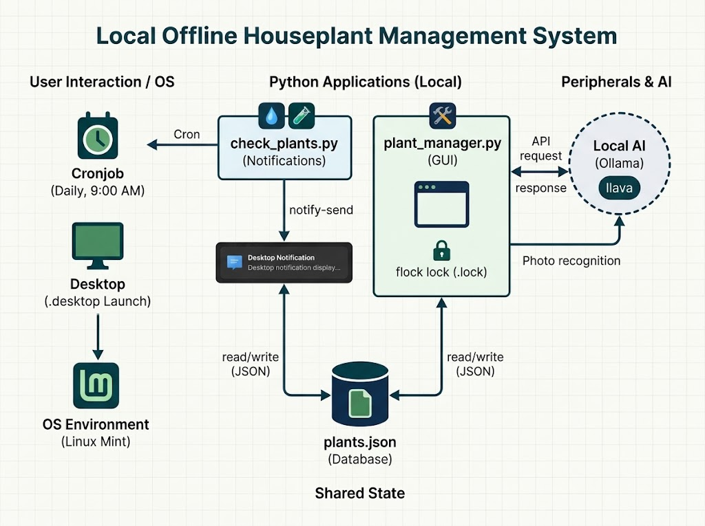

# 🌱 Planten Beheer App

Een lokaal, privacy-vriendelijk beheersysteem voor kamerplanten. Geschreven in Python en geoptimaliseerd voor Linux Mint (Cinnamon).


## Architectuur & Werking

De applicatie draait volledig offline op je lokale systeem en bestaat uit een achtergrondservice voor notificaties, een beheeromgeving, en een lokaal AI-model voor fotoherkenning.



### Onderdelen in deze map:
* **`plants.json`**: De lokale database waarin de statussen, water- en voedingsintervallen van al je planten zijn opgeslagen.
* **`plant_manager.py`**: De grafische Tkinter-interface (1200x1200px, 20 high listbox) om je planten te beheren.
  - *🔒 Single Instance Lock*: Maakt gebruik van een fcntl lock-file (`.plant_manager.lock`) om te voorkomen dat de app meerdere keren tegelijk opent.
  - *👁️ Lokale AI*: Bevat een 'Identificeer via Foto'-knop die een geselecteerde foto naar je lokale Ollama-service stuurt (`llava` model) om automatisch de plantennaam te herkennen.
* **`check_plants.py`**: Het achtergrondscript dat berekent of planten water of voeding nodig hebben en dit via native desktopnotificaties (`notify-send`) meldt.

---

## 🛠️ Installatie & Setup

### 1. Vereisten
Installeer de benodigde Python-bibliotheek voor de Ollama API-calls:
```bash
pip install requests
