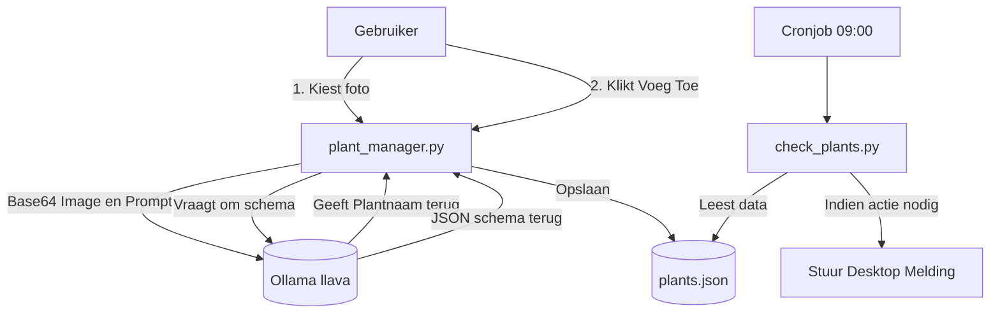

# 🌱 Planten Beheer App

Een lokaal, privacy-vriendelijk beheersysteem voor kamerplanten. Geschreven in Python en geoptimaliseerd voor Linux Mint (Cinnamon).

## 🏗️ Systeem Architectuur (Tweetraps AI)

De applicatie draait volledig offline en maakt gebruik van een slimme, dubbele integratie met een lokaal LLM (Ollama).

### Onderdelen in deze map:
* **`plants.json`**: De lokale database waarin de statussen, water- en voedingsintervallen van al je planten zijn opgeslagen.
* **`plant_manager.py`**: De grafische Tkinter-interface (1200x1400px) om je planten te beheren.
  - *🔒 Single Instance Lock*: Maakt gebruik van een fcntl lock-file (`.plant_manager.lock`) om te voorkomen dat de app meerdere keren tegelijk opent.
  - *🧠 Tweetraps AI*: Identificeert planten via foto's en genereert direct het bijbehorende verzorgingsschema.
  - *✅ Dynamische Takenlijst*: Een overzicht van openstaande taken (water/voeding) dat multi-select ondersteunt (met Ctrl of Shift) om meerdere planten in één keer af te vinken.
* **`check_plants.py`**: Het achtergrondscript dat berekent of planten water of voeding nodig hebben en dit via native desktopnotificaties (`notify-send`) meldt.

---

## 🛠️ Installatie & Setup

### 1. Vereisten
Installeer de benodigde Python-bibliotheek voor de Ollama API-calls:
`pip install requests`

Zorg dat je lokale Ollama-service actief is en haal het vision/taal-model op:
`ollama pull llava`

### 2. Snelkoppeling (Desktop & Menu)
Om de manager direct te kunnen starten, staat er een snelkoppeling in deze map. Je kunt deze kopiëren naar je desktop of je applicatiemenu:
`cp ~/tools/plants/PlantenBeheer.desktop ~/.local/share/applications/`

### 3. Automatische Dagelijkse Check (Cronjob)
Om elke ochtend om 09:00 uur automatisch een notificatie te krijgen, voeg je het achtergrondscript toe aan je cronjobs.

Open je crontab:
`crontab -e`

Voeg de volgende regel onderaan toe:
`0 9 * * * export DISPLAY=:0 && export DBUS_SESSION_BUS_ADDRESS="unix:path=/run/user/$(id -u)/bus" && /home/$USER/tools/plants/check_plants.py`
