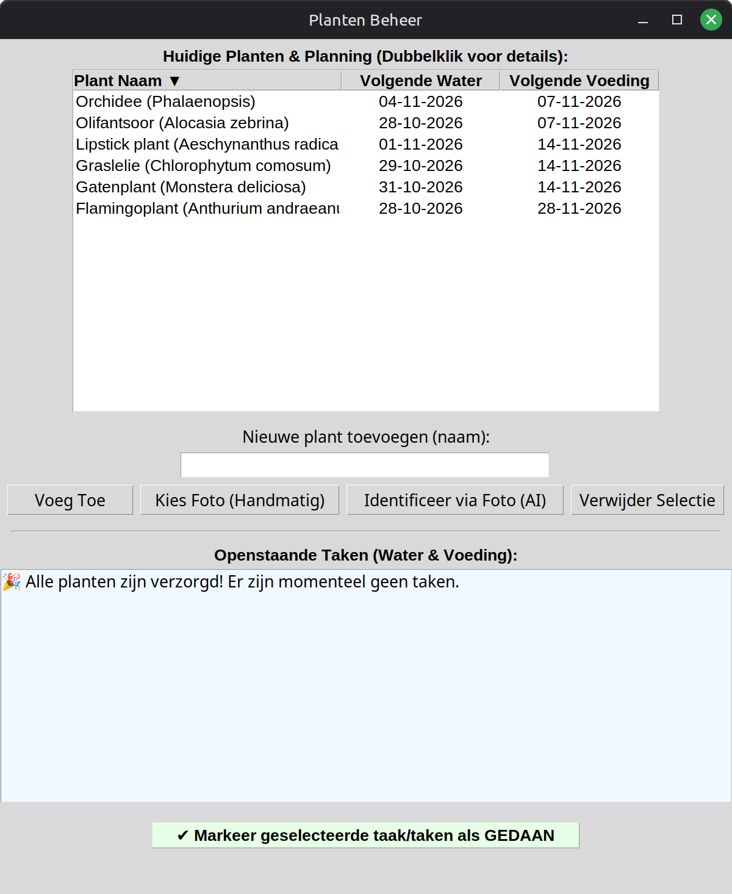

# 🌱 Planten Beheer App

Een lokaal, privacy-vriendelijk beheersysteem voor kamerplanten. Geschreven in Python (Tkinter) en geoptimaliseerd voor Linux Mint (Cinnamon).



## 🚀 Huidige Functionaliteiten

- **Visuele Tabel & Sortering:** Overzichtelijke weergave van planten, volgende waterbeurt en voeding. Klik op de kolomkoppen om te sorteren (start standaard gesorteerd op water-datum).
- **Detailscherm (Modal):** Dubbelklik op een plant voor een pop-up met lichtbehoefte, wateradvies, extra tips en een plantfoto.
- **Foto Koppeling:** Mogelijkheid om foto's automatisch via AI (Ollama llava) te koppelen of handmatig toe te voegen/te wijzigen.
- **Takenlijst:** Automatische detectie van achterstallig onderhoud met multi-select om taken in één keer af te vinken.
- **Offline & Privacy-first:** Draait volledig lokaal in combinatie met Ollama en slaat data op in een lokaal JSON-bestand.
- **Geautomatiseerde Notificaties:** Achtergrondcontrole via cron in combinatie met een wrapper-script (`run_check.sh`) voor betrouwbare desktopnotificaties (`notify-send`).

## 🏗️ Systeem Architectuur (Tweetraps AI)

De applicatie draait volledig offline en maakt gebruik van een slimme, dubbele integratie met een lokaal LLM (Ollama).

```mermaid
graph TD
    A[Gebruiker] -->|1. Kiest foto Handmatig/AI| B(plant_manager.py)
    B -->|Base64 Image + Prompt| C[(Ollama: llava)]
    C -->|Plantnaam bijv. Monstera| B
    A -->|2. Klikt Voeg Toe| B
    B -->|Prompt: schema, licht & tips| C
    C -->|JSON schema data| B
    B -->|Opslaan incl. fotopad| D[(plants.json)]
    E[Cronjob 09:00 via run_check.sh] --> F(check_plants.py)
    F -->|Leest data| D
    F -->|Actie nodig?| G[notify-send Desktop Melding]