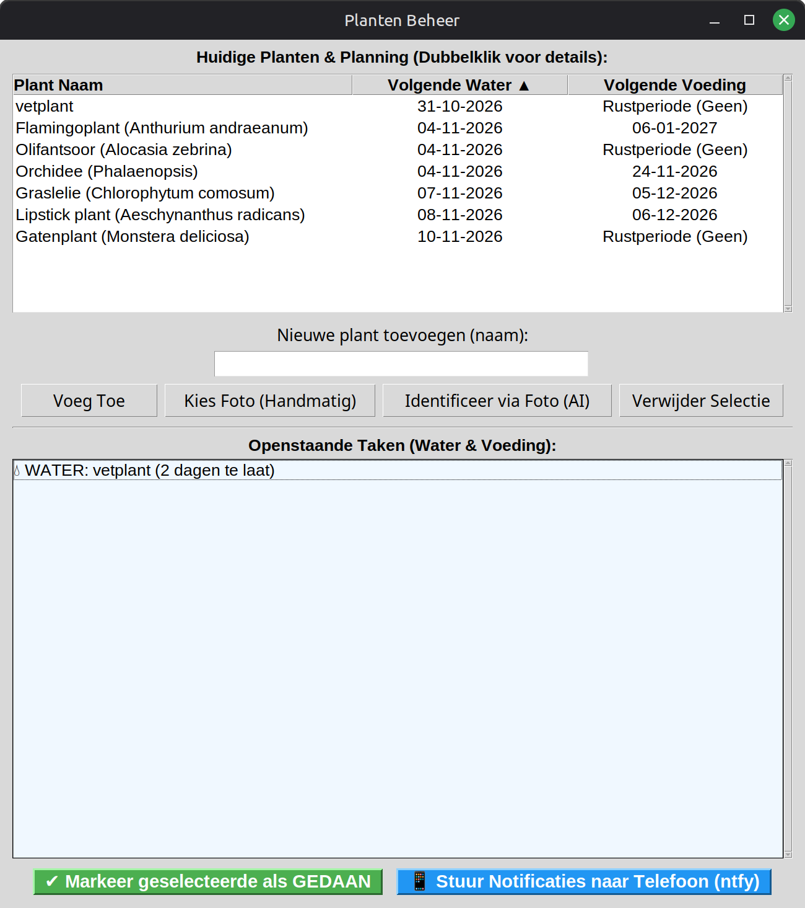

# 🌱 Planten Beheer App

Een lokaal, privacy-vriendelijk beheersysteem voor kamerplanten. Geschreven in Python (Tkinter) en geoptimaliseerd voor Linux Mint (Cinnamon), met een headless backend voor automatische notificaties op een Raspberry Pi.



## 🚀 Huidige Functionaliteiten

- **Visuele Tabel & Sortering:** Overzichtelijke weergave van planten, volgende waterbeurt en voeding. Klik op de kolomkoppen om te sorteren (start standaard gesorteerd op water-datum).
- **Detailscherm (Modal):** Dubbelklik op een plant voor een pop-up met lichtbehoefte, wateradvies, extra tips en een plantfoto.
- **Foto Koppeling:** Mogelijkheid om foto's automatisch via AI (Ollama llava) te koppelen of handmatig toe te voegen/te wijzigen.
- **Takenlijst:** Automatische detectie van achterstallig onderhoud met multi-select om taken in één keer af te vinken.
- **Volledig Onafhankelijk (Geen Cloud):** Draait 100% lokaal zonder afhankelijkheid van externe clouddiensten zoals Nextcloud. Data wordt opgeslagen in een relatief geplaatst `plants.json` bestand.
- **Snelle Deployment:** Eén-klik deployment (`deploy_naar_pi.sh`) via `rsync` en SSH naar een Raspberry Pi.
- **Geautomatiseerde Push Notificaties:** Dagelijkse achtergrondcontrole (cronjob) op de headless Raspberry Pi verstuurt geruisloos pushnotificaties naar een smartphone via de `ntfy`-API, en logt lokaal de output (`cron.log`).

## 🏗️ Systeem Architectuur (AI GUI & Headless Backend)

De applicatie is opgesplitst in een grafische frontend voor lokaal beheer (met lokale AI-integratie) en een robuuste backend-taak op de Raspberry Pi voor monitoring.

```mermaid
graph TD
    subgraph Laptop (Linux Mint)
        A[Gebruiker] -->|1. Kiest foto Handmatig/AI| B(plant_manager.py)
        B -->|Base64 Image + Prompt| C[(Ollama: llava)]
        C -->|Plantnaam & JSON schema data| B
        B -->|2. Klikt Voeg Toe| B
        B -->|Opslaan in zelfde map| D[(plants.json)]
        B -.->|3. Handmatige push via deploy_naar_pi.sh| P
        D -.->|Sync via rsync/SSH| P
    end

    subgraph Raspberry Pi (Headless server)
        P[(Lokale map: ~/plants)]
        E[Cronjob 08:00 via user frank] --> F(check_plants.py)
        F -->|Leest actuele data| P
        F -->|Actie nodig?| G[ntfy.sh API Post]
        F -->|Errors / Succes| L[cron.log]
    end

    subgraph Mobile
        G -->|Pushbericht| H[Smartphone]
    end